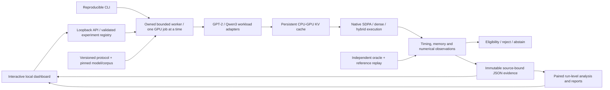

# Atlas

**Long-context validation is running.** The separate [v3 protocol and reproduction
instructions](docs/research/attention-v3/reproduce.md) add full saved model-logit
arrays, an unchanged native repeat, a native-cache control, six separate long
books and balanced method order. The local app's **Long-context evidence** page
shows every registered outcome and independently verified partial results.
Failures and out-of-memory controls block eligibility. No complete v3 outcome,
universal speed benefit or external reproduction is implied while cases remain.

## System architecture



The worker executes reviewed builtin adapters using local safetensors. The backend binds to this computer, validates requests, serializes GPU work and owns cancellation/timeout cleanup. Scientific validity is assessed separately from execution completion. Windows job ownership is a lifecycle boundary, not a hostile-code sandbox or exclusive hardware allocation.

The [v2 research study](docs/research/attention-v2/report.md) adds a single-storage ring cache, GQA, a separate NumPy float64 oracle, pinned Qwen3/public-text workloads, matched FP32/FP16/BF16 comparisons, independent process blocks, full-generation timings, real 32k/40k memory-pressure cases and explicit rejection/abstention. Its dashboard distinguishes execution status from numerical eligibility and shows process-level uncertainty. The [frozen protocol](docs/research/attention-v2/protocol-amendment-1.json), [work ledger](docs/roadmap/research-v2-plan.md) and [reproduction kit](docs/research/attention-v2/reproduce.md) record measured scope and remaining limits. The report states whether all planned cases have finished.

**These benchmarks cannot be described as 100% accurate or unbiased.** Failed logit checks remain failures; full-pressure numerical quality is unknown. Public-text selection, small process counts, shared Windows hardware and one modern model family limit generalization. There is no measured CXL/DSA execution, external independent replication or established policy superiority.

**New: [Attention Lab](docs/attention-lab.md)** is an executable local CPU-GPU attention workspace, with real CUDA benchmarks, a pretrained GPT-2 integration, persistent KV caches, and an interactive dashboard. Launch with `./Start-Atlas.ps1`. Its [architecture and review](docs/architecture/hybrid-attention-lab.md) distinguish this owner-authorized engineering track from the historical training proposal below. This is dense attention, not a CXL implementation or a reproduction of HGCA/BEYOND's sparse runtime.

A research and engineering specification for a local scientific-fidelity-aware ML compute optimizer.

**Verdict: advance the evaluation package; define a distinct policy before a superiority study.** Existing systems cover memory optimization, state-aware checks and conditional invariants. [The comparison audit](docs/research/15-comparison-identifiability.md) requires an explicit additional decision algorithm before an equally informed baseline can be a distinct treatment. Standalone novelty and useful expanded access remain unestablished.

Start with the [updated recommendation](docs/research/14-updated-recommendation.md), [research index](docs/research/README.md), [claim-to-evidence map](docs/research/evidence-map.md) and [assignment deliverable audit](docs/research/deliverable-audit.md). The package includes individual prior-art notes with read scopes, competitor analysis, scientific-fidelity framework, architecture/API/security blueprint, seven ADRs and a phased roadmap. The [amendment ledger](docs/research/13-audit-and-amendments.md) preserves corrections and negative results.

## What the evidence establishes

- Original CPU semantic/state/update controls and statistical audits expose known failure mechanisms and assumption limits. The current CPU/Windows lifecycle suite has 56 passing tests, including generated accumulation partitions, QA-window coverage and evidence-tamper controls. These are authored controls, not independent field-risk estimates; two Windows lifecycle tests explicitly skip on Linux.
- [Synthetic GPU measurements](docs/research/experiments/cuda-memory-probe.md), a labeled [allocator-cap control](docs/research/experiments/cuda-budget-probe.md), and [twelve native selective-checkpoint trials](docs/research/experiments/native-selective-control.md) show resource/time tradeoffs on one physical 12 GB RTX 3060. Existing native selective checkpointing strengthens the baseline Atlas would need to beat.
- [Six five-epoch real-data CNN pilots](docs/research/experiments/fashion-pilot.md) show about 32.7% lower allocated memory and 66.4% longer summed synchronized update time for the combined native plan. Three paired validation differences are exploratory; both arms already fit.
- [Sixteen pretrained BERT/QA segments](docs/research/workload-screen/qa-resource-pilot.md) complete with native attention/checkpoint/microbatch tradeoffs. Eager allocation exceeds nominal physical capacity on Windows; completion does not prove exclusive VRAM fit. A separate control catches invalid launcher-only host-memory monitoring, retained with an amendment.
- [The constructor default](docs/research/workload-screen/qa-default-attention-control.md) already selects native SDPA. [Owned-worker numerical checks](docs/research/workload-screen/qa-numerical-control.md), [adaptive-update replay](docs/research/workload-screen/qa-adam-sensitivity-control.md) and [logical-32 reference-noise measurements](docs/research/workload-screen/qa-reference32-control.md) clarify comparison limits. Unchanged references themselves exceed a stated diagnostic threshold in a few selected elements; a literal mismatch alone cannot attribute a fault to a transformation.
- [Composite-loss controls](docs/research/experiments/composite-objective-control.md) add per-head denominator, empty-mask and model-dependent-normalization boundaries with repaired positive controls. The [interface refinement](docs/architecture/objective-and-evidence-boundaries.md) separates intent, reference, execution and evidence.
- Reviewed [TrainParity controls](docs/research/experiments/trainparity-controls.md), adapted [Rockmate-family planning](docs/research/experiments/rockmate-compatibility.md) and [compatible-stack streaming integration](docs/research/experiments/interop-controls.md) execute. The streaming adaptation reuses existing snapshot/comparison code successfully; no new generic checker is justified by these results.
- [Execution-order](docs/research/experiments/planner-reuse-control.md), [comparison/health](docs/research/experiments/comparator-contract-control.md) and [shared-reference token-objective](docs/research/experiments/token-reference-control.md) controls clarify exact evidence boundaries. A differential PASS does not establish that its supplied reference implements the intended experiment.
- [Six same-seed energy replays](docs/research/experiments/board-energy-control.md) preserve training identities and retain full shared-board traces. Counter energy rises in each combined-plan pair, while integrated power and counters disagree materially. Independent arithmetic is checked; calibrated process/whole-host energy is not established.

**No primary held-out policy advantage, useful real-workload OOM rescue, powered full-training equivalence, local-LLM benefit or preservation of scientific conclusions has been established.** The training/optimization runner remains unbuilt; the dashboard below inspects saved results. No independent expert labels were obtained; the [adjudication procedure](docs/research/adjudication-protocol.md) prepares that remaining gate.

The [resource figure](docs/research/workload-screen/qa-resource-pilot.md), [workflow cost ledger](docs/research/workload-screen/qa-workflow-costs.md), [eight-environment reconciliation](docs/research/workload-screen/post-study-environments.md) and [claim-applicability design](docs/architecture/claim-applicability.md) separate measured quantities from claims they cannot establish. The cost ledger covers 25 worker windows/34 BERT model executions/144 updates, not the complete research or selection workflow.

## Research dashboard

The [private Atlas dashboard](https://atlas-research-dashboard.andrewdang357.chatgpt.site) provides a read-only experiment browser, resource comparison, scoped evidence inspector and environment inventory. It uses a small source-bound snapshot with browser-local filtering and export. This is the owner-requested inspection UI; the proposed training/optimization runner remains unbuilt. See [preview, refresh and publication instructions](frontend/README.md).

## Reproduce the bounded CPU checks

With Python 3.12 and uv 0.13.1:

```text
uv sync --locked
uv run --locked python benchmarks/audit_specification.py
uv run --locked pytest -q
uv run --locked python benchmarks/semantic_probes.py --output artifacts/replayed-cpu-probes.json
```

The core lock uses the official PyTorch CPU index. [Separate dependency/environment records](docs/research/dependencies-and-licenses.md) identify CUDA, checker, planner, shared-stack and telemetry scopes; core CI does not rerun foreign packages or GPU experiments. Linux/Windows CI additionally reconstructs saved energy arithmetic/replay identities and checks the derived record. Data, weights, external reference source/PDFs and large artifacts remain outside tracked files.

## Immediate next implementation

Advance the evaluation package under [ADR 007](docs/research/decisions/007-benchmark-first.md). Any trusted adapter/profiler slice in the [acceptance criteria](docs/roadmap/mvp-acceptance-criteria.md) must include the [objective and worker-boundary amendment](docs/architecture/objective-and-evidence-boundaries.md). Preserve competent native/existing-checker baselines, repair/test ownership before more supervised training, and specify a distinct policy before expanding mechanisms, FastAPI/MLflow, Ollama or the frontend.

This private repository was created separately from the read-only ChatGPT project mirror. Synced reference files were preserved. The [chronological log](docs/research/12-research-log.md) records actual work, attempted runs and unfinished evidence; it makes no artificial five-hour claim. Public licensing remains an owner decision.
