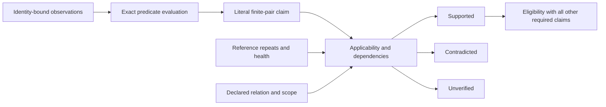

# From observations to applicable claims

This specification refines the proposed [component interfaces](components.md) using the executed [logical-32 reference diagnostic](../research/workload-screen/qa-reference32-control.md), [relation controls](../research/experiments/qa-gauge-control.md) and [worker lifecycle](../research/workload-screen/windows-job-control.md). No production schema, aggregation engine or generic verifier is implemented by this document.

## Four separate records

| Record | Required content | Example |
|---|---|---|
| Execution outcome | Owned job identity, stage, attempts/successful work, supervisor reason, exit/payload/cleanup | A canceled job may exit zero; completion still requires the declared work and no conflicting stop reason |
| Observation | Artifact identity, producer/observer version, field, scope/unit/window, value and measurement applicability | Launcher RSS is measured but cannot satisfy an actual-worker RSS budget |
| Predicate evaluation | Exact field set/mask, implementation/precision, thresholds, operands and observed result | A float64 selected-array bound is distinct from an existing float32 tensor comparator, even with identical tolerance numbers |
| Claim assessment | Intended relation, scope, assumptions/dependencies and supported/contradicted/unverified status | A failed comparison between two references does not identify a candidate transformation as its cause |

Keep an observed comparison failure visible. Applicability determines which claim it can inform; it does not turn an inconvenient FAIL into PASS. Likewise, a successful resource segment supports its declared execution claim while full-training quality remains unverified.

## Scope and dependency rules

1. Every claim identifies the input/data/method, logical batch, execution relation, fields, phase/horizon and relevant environment/backend. A result on three features is not a logical-32 reference. An eight-update segment is not complete fine-tuning.
2. Assess reference admissibility/self-consistency under the declared relation before attributing candidate differences. Retain its raw health/repeat results. An unstable reference blocks an attribution claim; it does not prove the candidate is scientifically invalid. The exact finite comparison remains an observation.
3. A required literal parameter relation can be contradicted by a bias change even when a separately declared functional relation holds. Neither relation overrides the other automatically. The tiny float32 large-bias control also shows why a real-arithmetic invariance requires precision/range assumptions before it can support a finite claim.
4. Selected-field agreement supports only those fields. Whole-state hashes are byte identities under the recorded convention, not numerical distances or observations of missing optimizer/scheduler/scaler state.
5. Stale identities, missing observations and unsupported executors remain unverified. A known observer-scope defect invalidates the affected inference; it does not invalidate unrelated GPU fields or permit retroactively filling the missing worker-memory measurement.
6. The same facts, relations, predicates and adaptation allowance go to the strong baseline. A new functional observation or corrected denominator cannot count as an Atlas advantage over an uninformed comparator.

The logical-32 diagnostic observes 5/2 position-embedding parameter elements beyond its declared bound in two same-recipe reference pairs. That contradicts the specified finite bound for those pairs. Because no candidate transformation occurs there, a claim that the transformation caused those differences is unverified. Scientific quality is also unverified. Do not label this an upstream checker defect or estimate a population false-alarm rate from dependent elements.

## Proposed aggregation

A future `ClaimAssessment` needs `claim_id/version`, dimension, status, intended relation, applicability (`matched`, `mismatch`, `unresolved`), dependency IDs, assumptions, scope and exact evidence references. A `PredicateEvaluation` retains its actual result independently. Numeric precision, nonfinite policy and conversion rules are part of predicate identity; a named rtol/atol pair is insufficient.

Selection eligibility requires support for every required claim and no incompatible method precondition. A contradicted required finite relation prevents that contract's acceptance. An unverified required claim also prevents acceptance but is not silently relabeled as a demonstrated semantic violation. Optional unverified dimensions stay visible. If no plan qualifies, return no justified plan with the relevant reasons; do not enlarge tolerances, alter the method, waive fields or switch relations automatically.

A resource-only operational contract can report a completed segment and measured allocator tradeoff while scientific relations remain unverified. Its UI/report must name that scope explicitly; it cannot use the phrase scientifically safe merely because its own smaller requirement set passed. Contract changes create a new prospective study/version and do not change past results.

## Operational implementation obligations

- Bind payloads to owned job, spec, worker/observer and input identities. Exit code, payload completeness, counters and supervisor stop events must be reconciled. A late cancellation can coexist with completed subwork; retain the ordered facts rather than silently resuming a partial optimizer state.
- Validate field-level units and observed coverage. Windows job commit, actual RSS, Torch allocation/reservation and board-wide telemetry are distinct. Soft monitoring thresholds are not hard quotas or exclusive physical-VRAM proof.
- Preserve raw artifacts plus amendments. Freeze or version changed helpers; the executed QA diagnostics retain prior supervisor identities instead of rewriting their old source association. A future registry should resolve explicit versions without arbitrary API import/interpreter paths.
- Record nested cost windows. Parent initialization, environment construction, source checking, capture, comparison, file export and failed trials must be included in total user cost when the study claims that estimand. A sum of selected worker intervals is not an entire research-turn or end-to-end policy cost.

For future QA quality claims, separately freeze the evaluation split, legal context-span filtering, maximum answer length, window aggregation, text normalization and metric implementation. The [prospective QA evaluation specification](../research/workload-screen/qa-quality-evaluation-spec.md) defines required artifacts, coverage guards and decoder controls. None is implemented or measured by the present resource/first-update controls. Their absence must not be filled by a parameter-distance heuristic or an LLM verdict.
