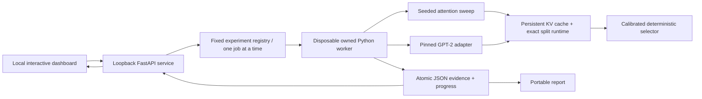

# Atlas Attention Lab

Owner-authorized implementation track, 2026-10-17. This supplements the historical training evaluation package and ADR 007. It does not claim CXL implementation or research novelty.

## Question and boundaries

When does exact dense CPU-GPU split attention outperform moving offloaded KV entries to the GPU on this consumer PC? Can calibration select a useful execution plan on unseen lengths? The runtime retains every entry; unlike HGCA/BEYOND, this first study does not sparsify. Native PyTorch SDPA is the strong resident-GPU comparator. Model integration uses pretrained GPT-2 with its stock positional limit. Synthetic attention sweeps are separate from model inference.

## System

CLI and API invoke the same registered workers. No arbitrary import paths, commands, interpreters, file writes, remote model code, or untrusted checkpoints are accepted. Downloads occur in explicit asset preparation; inference uses local safetensors offline. The worker owns its CUDA context. The server remains responsive and serializes GPU jobs. A cooperative cancel file is checked between bounded trials; a watchdog terminates only its owned worker on wall timeout. Workers spawn no children. Server binds 127.0.0.1; mutations require same-origin requests and a per-session token. Outputs live in artifacts/attention-lab, outside sources/.

## Runtime contract

- Decode query layout B,H,1,D, float32. Explicitly reject training, padding, cross attention and unsupported shapes. Prefill uses causal native SDPA; subsequent decode includes all previously cached tokens.
- Persistent cache holds old entries in host RAM and recent entries in GPU memory. Model cache never re-materializes its whole history on GPU for the hybrid path. Cache append, eviction and transfer costs are included in model token time.
- Compute partial output and log-sum-exp per device; fuse using normalized exp(lse_i-logaddexp(lse_cpu,lse_gpu)). Never average independently normalized outputs. CPU/GPU boundary cases and large scores need controls.
- Seven fixed plans across five execution families: resident native SDPA, direct GPU dense attention, CPU-only dense attention, copy-to-GPU native SDPA, and three dense hybrid splits. Adaptive selects from measured fixed candidates using length interpolation with a deterministic tie break and explicit KV budget; it does not claim a new attention algorithm.
- Reference is independent float64 dense attention for finite synthetic cases; full pretrained-model logits are checked against native SDPA on the same teacher-forced token history. Predeclared float32 atol=1e-4, rtol=1e-4. Record failed bounds, max absolute error and relative L2. Greedy token agreement is diagnostic, not language-quality equivalence.

## Benchmark protocol

Seeded CPU tensors are the common input; input hashes, source hashes, dirty-diff hash, package versions, hardware, timing samples and configuration are retained. Warm up all methods. Synchronize CUDA before and after each wall-time sample. Shuffle candidate order per length. Do not substitute CUDA-event kernel time for end-to-end time. Record setup separately. Latencies show median and p90 plus raw samples; allocated memory is an allocator measurement, not exclusive VRAM residency. Desktop interference remains possible.

Calibration lengths and held-out lengths are disjoint. Selector cost/calibration cost are recorded, as are the best budget-eligible fixed comparator, per-case budget-eligible measured optimum and regret. Measured optimum is descriptive and cannot supply the policy with held-out timing. Model uses the policy calibrated before its timing and retains model-loading, prefill and decoding costs separately.

## Architecture review before implementation

Reviewed 2026-10-17 by the implementing agent, not an independent reviewer.

| Failure risk | Design decision / required evidence |
| --- | --- |
| Model framework rebuilds full GPU KV before offload | Own the GPT-2 attention cache; compare allocation and inspect code path |
| Incorrect fusion of separate softmax results | LSE fusion; uneven partition, empty side and extreme-score tests |
| Faster result changes attention semantics | Dense identical-entry contract; independent float64 oracle and model-logit comparison |
| Weak baseline | Native SDPA resident and transfer baselines; fixed split chosen on calibration only |
| Training on evaluation timings | Frozen calibration artifact; disjoint validation shapes; explicit policy lineage |
| Cache construction hidden in speed claims | Setup ledger for layer benchmark; append/eviction included in model decode |
| Dashboard is disconnected from measurements | UI starts registered jobs, polls saved worker records, filters/export actual observations |
| Browser can launch arbitrary work | Fixed schemas, bounded dimensions, loopback + origin/host/token checks |
| Hanging or concurrent GPU workers | Single job registry, cancellation and wall deadline; lifecycle tests |
| Resource claim overreach | No CXL, hardware quota, full model quality or novelty claims |

## Completion evidence

Meaningful runtime tests, cancellation/API controls, real CUDA sweeps, pretrained model inference through all supported methods, an inspected browser UI with working run/filter/detail/export/model actions, architecture/research notes, exact environment export and a one-command local launcher. Negative performance findings remain visible.
