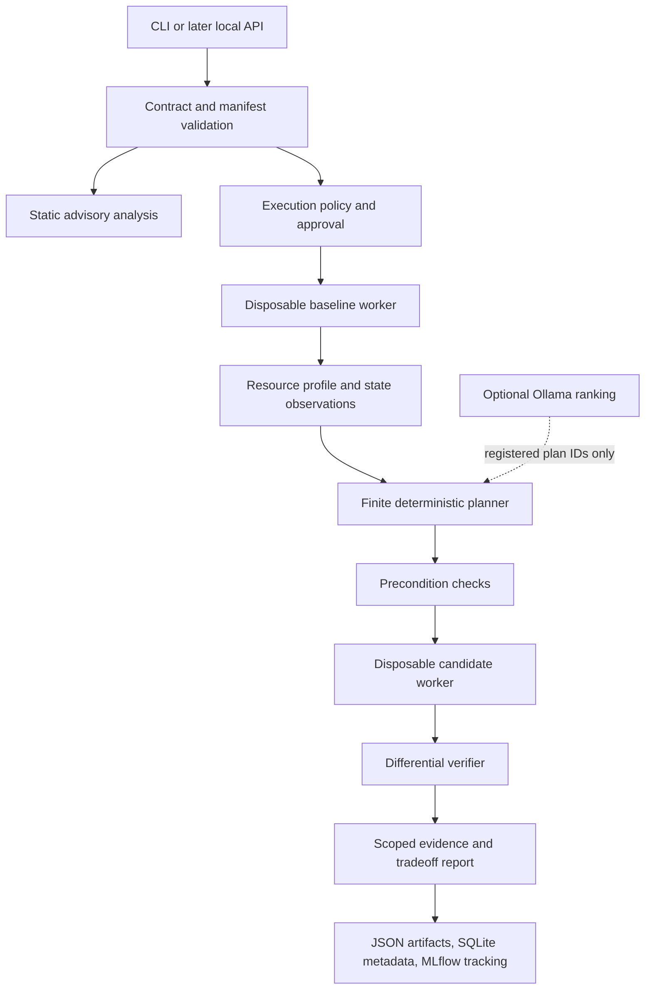

# Architecture overview — specification

No Atlas application is implemented yet. The chosen architecture is a small local Python process supervisor with trusted workload adapters, native PyTorch strategies and evidence-bound reports. It is not a multi-agent system or a distributed platform.

## Design decisions

Use explicit adapters rather than arbitrary-loop rewriting. The planner enumerates supported config changes and checks their compositions. It can reject, abstain or return no plan. Each worker gets a fresh initialization, data/RNG replay recipe, explicit budget and unique output directory. Never mutate the source checkout or continue a candidate from a failed partial baseline.

Keep Python 3.12 and PyTorch 2.x. Add FastAPI/Pydantic as a typed service after the CLI works; no background training inside request handlers. SQLite stores Atlas control metadata, while MLflow owns its own tracking database/artifacts. JSON remains the portable evidence format; Parquet is optional for larger numeric tables. React/TypeScript/Vite/Tailwind is a later inspection client. Docker is optional trusted-environment packaging, not a security guarantee. Ollama is optional and replaceable.

## Invariants

- Results refer to immutable code/config/contract/plan/environment/input identities.
- A profile requires authorized execution; static scanning does not import target code.
- A candidate cannot modify hard contract requirements, allowed paths or numerical/statistical margins.
- No single score collapses memory savings and scientific validity.
- Unknown/missing evidence cannot be promoted to pass.
- CPU-only reports use null for GPU-only fields, with reason and support status.
- Full-run conclusions cannot inherit authority from short probes.

See [components](components.md), [data flow](data-flow.md), [API](api-design.md), and [security](security.md). Major decisions are recorded in [ADRs](../research/decisions/README.md).
