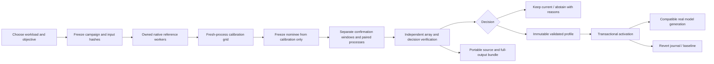

# Runtime autotuner implementation contract

Pre-implementation contract, 2026-10-18. Read the
[research review](../research/autotuning/research-and-design.md) first. The tuner
is a new full-model track; the frozen attention-study execution files remain
unchanged. Proposed components below require implementation and verification.

## Components

- `tune.py`: separate registered CLI, worker and wrapper-service entry point.
- `src/atlas/tuning/`: registry/identity, execution, owned controller, pure policy,
  independent NumPy verification, profile transactions and local API.
- `lab-ui/`: tuning workflow within the existing dashboard, factual run states,
  measured candidate/confirmation tables, profile apply/revert and real generation.
- `artifacts/atlas-tuning/`: immutable campaign protocols, mutable execution ledgers
  until terminal, actual run arrays/source/logs, local profile state and private
  inference requests. Public research exports explicitly select campaigns.
- `docs/research/autotuning/`: sources, protocol decisions, measured reports,
  reproduction and final acceptance receipts. Large outputs remain outside Git.

The wrapper app reuses the loopback origin/token boundary, adds tuning routes
before the existing static app and blocks conflicting GPU jobs across old/new
interfaces. Existing registered lab experiments remain available. Startup/stop
helpers must recognize and verify the new exact checkout entry point.

## Campaign state and evidence

States are preflight, references, calibration, nomination, confirmation,
verification, completed/failed/cancelled/timed_out. Keep decision outcomes
(improvement, memory fit, keep current, inconclusive, no eligible profile)
separate from execution status. No activation before full independent verification.

Protocol includes the finite profile registry, baseline, objective, exact input
token hashes, source/asset/package identities, warmup/timing/numerical relations,
orders, confirmation template, bounds and failure rules. Nomination is a separate
immutable artifact. Confirmation instances are derived from its frozen template;
they cannot introduce a newly selected setting after seeing confirmation.

Each worker retains actual process identity, source snapshots, full 32-by-vocabulary
FP32 logit arrays, token history, timings, allocation peaks, observations and failures.
Reference arrays can be shared by hash within a campaign. The independent verifier
checks registered case/config/order, source/array identities, all numerical decisions,
timing arithmetic, controls, selection, confirmation and eligibility. It uses
NumPy without importing PyTorch execution or trusting the controller's winner.

## Profile state and application

Use standard-library SQLite transactions for active-profile pointers, events,
accepted cancellations and committed campaign decisions. Profile artifacts are
immutable JSON with evidence digests. Compare the expected active profile for
the exact execution domain at activation/revert. An accepted cancellation and a
profile commit serialize in one transaction; a late cancel cannot pretend that
already applied settings were reverted. The UI reads authoritative active state.

The domain binds the registered model, precision, exact prompt/output token
counts and execution identity. Automatic activation changes Atlas's compatible
future model runs. It does not change OS settings or another application's model.
Runtime application checks identity and evidence. Fallback is explicit and cannot
silently violate a memory goal. Output records distinguish historical profile
checks from a fresh numerical replay. Startup and verification costs remain visible.

## Lifecycle and portability

The controller owns fresh workers through the existing Windows job implementation;
store launch and actual execution identities, terminal exit and closed-scope evidence.
One campaign holds the workspace GPU lock. Cross-workspace and external GPU use
remain outside that lock. CPU controls cover failure/cancel/timeout paths; actual
browser and CUDA tests must exercise the positive path and cancellation cleanup.

The initial validated runtime is Windows/NVIDIA using the existing hash-pinned
environment. Portable arithmetic verification does not establish Linux CUDA or
another adapter. No new package dependency is required. Bundles contain selected
public-text campaign source and full outputs, not weights, environments, private
prompts, credentials or unrelated generated data. Imported results are reference
evidence; they cannot become fake fresh local runs or silently activate elsewhere.
